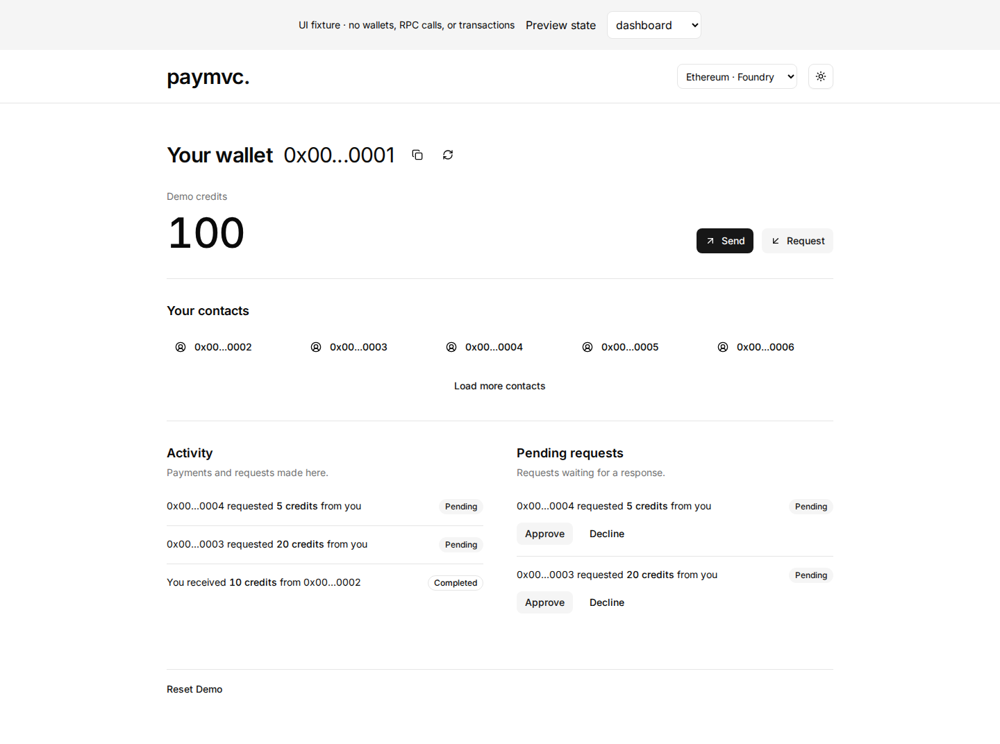
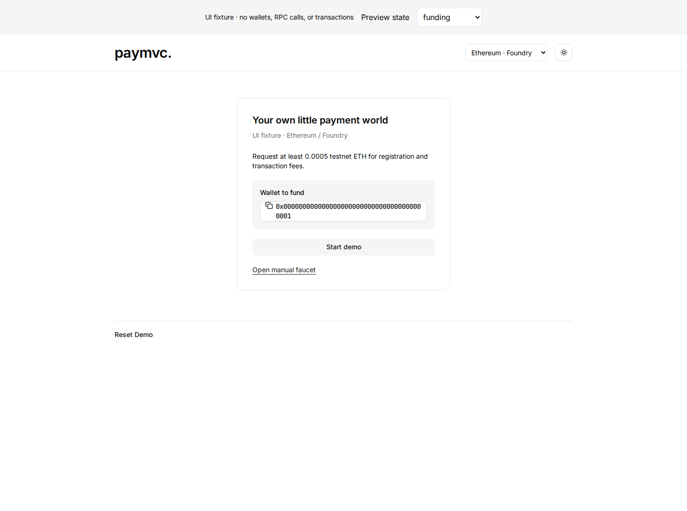
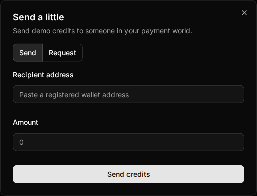

# User interface

Every implementation shows the same interface. The view code is shared: copy `src/components/` from an existing implementation without changes. This page describes what the interface shows and why, so that you can check your implementation and review changes.



## Visual style

- shadcn/ui with the standard neutral theme, in light and dark mode.
- Inter variable font and Lucide icons.
- Black, white, and neutral grays. Use the destructive color only for errors and destructive actions.
- No brand colors, charts, performance comparisons, fee dashboards, or architecture explanations inside the app.

## Header

- The `paymvc.` logo links to the app home.
- The **Implementation** selector lists every implementation in this order: Ethereum, Base, Robinhood, Monad, Solana, Sui, Aptos, Stellar, Thruput. Each option shows the network and framework, for example "Solana · Anchor".
- The theme toggle has the accessible label **Dark mode**. Its pressed state shows whether dark mode is on. It shows a sun in light mode and a moon in dark mode.
- The theme follows the system preference until the visitor chooses a mode. The choice is saved per origin, apart from wallet data. `public/theme.js` applies it before the first render, to prevent a flash. Theme switching works when storage is not available.
- The selector and the theme toggle have the same height.

## Setup



1. **Create demo wallet** saves one disposable wallet. It sends no transactions.
2. The funding screen shows the full address once, with a copy button, the estimated native-token budget, and a faucet link.
3. **Start demo** verifies the deployment and the funding, does any native preparation steps, and registers the wallet.

Show short, named progress messages during setup. Native preparation steps (for example, account creation) appear as named steps.

## Dashboard

- **Your wallet `1234...5678`**, followed by a copy button and a refresh button. Both are ghost icon buttons.
- **Demo credits**: the real token balance.
- **Send** and **Request** buttons. They open the payment dialog with an empty address.
- **Your contacts**: five other registered addresses in registration order, as ghost buttons. **Load more contacts** loads five more. While contacts load, the button shows "Loading contacts…" and is disabled. If there are no other users, show a short empty message.
- **Activity** and **Pending requests**: two columns of equal width on desktop, stacked on mobile. Each has a title, a description, and its own empty state.

### Activity rows

- One row per transfer and one per request, newest first.
- Each row is a sentence, for example "You sent 1234...5678 10 credits".
- The address uses the surrounding font, with an underline on hover. Selecting it opens the payment dialog with the full address filled in.
- A status badge is right-aligned on the same row: **Pending**, **Paid**, or **Declined** for requests, and **Completed** for transfers.
- A request keeps its position when its state changes.
- Show 50 rows, then **Load more**.

### Pending requests

- **Approve** and **Decline** appear only on pending requests addressed to the current wallet.
- Outgoing requests show their status only. The intended payer acts in their own session.
- Feedback for a request appears inside that request's row.

## Payment dialog



- One dialog for both actions, with a **Send** / **Request** toggle.
- **Recipient address** and **Amount** fields. Contact buttons fill the address. There is no dropdown and no contact list in the dialog.
- Switching between Send and Request keeps the address and the amount.
- While an operation is unresolved, the toggle and the inputs are disabled.
- Progress and errors show inside the dialog. On confirmed success the dialog closes. There is no separate success screen.
- The dialog traps focus and returns focus to its trigger when it closes. Inputs keep their values after an error.

## Transaction states

The interface shows each of these states. Each has a visual baseline.

| State           | What the user sees                                            |
| --------------- | ------------------------------------------------------------- |
| Pending         | A progress message                                            |
| Outcome unknown | An alert, **Recheck original operation**                      |
| Failed          | An alert, **Retry** and **Dismiss failed operation**          |
| Stale read      | "Balance may be out of date". The last balance stays visible. |
| Read-only tab   | "Read-only tab". Another tab owns the session.                |

**Recheck original operation** checks the saved transaction and never signs a new one. **Retry** shows when no transaction is saved, so the next attempt is signed new. **Dismiss failed operation** shows only when no saved transaction can still land.

## Reset

**Reset Demo** is a link in the footer. It opens a confirmation dialog. Reset removes local access to the wallet. It does not cancel pending transactions or remove chain state.

## Addresses

- Short form: four characters, three dots, four characters: `1234...5678`. A `0x` prefix is kept and not counted: `0x1234...5678`.
- Controls keep the full address in their value and accessible label. The short form is display text only; never use it to identify an account.
- The full address can always be inspected and copied.

## Accessibility

- Every control has a name. The canonical labels include Create demo wallet, Start demo, Implementation, Send, Request, Recipient address, Amount, Approve, Decline, Refresh, Load more, and Reset Demo.
- Keyboard use and visible focus everywhere.
- Status messages use `role="status"`; errors use alerts.
- Layouts work at 390×844 (mobile) and 1440×1000 (desktop).
- Browser tests run axe.

## Design fixture

The Ethereum implementation includes a static fixture for design review. It uses fixed data and makes no chain calls.

```sh
cd implementations/ethereum/foundry
npm ci
npm run dev
```

Open <http://127.0.0.1:5173/reference.html>. **Preview state** selects entry, funding, setup, dashboard, pending, unknown, failed, stale, and read-only states. `reference.html?state=100-contacts` shows a long contact list.
